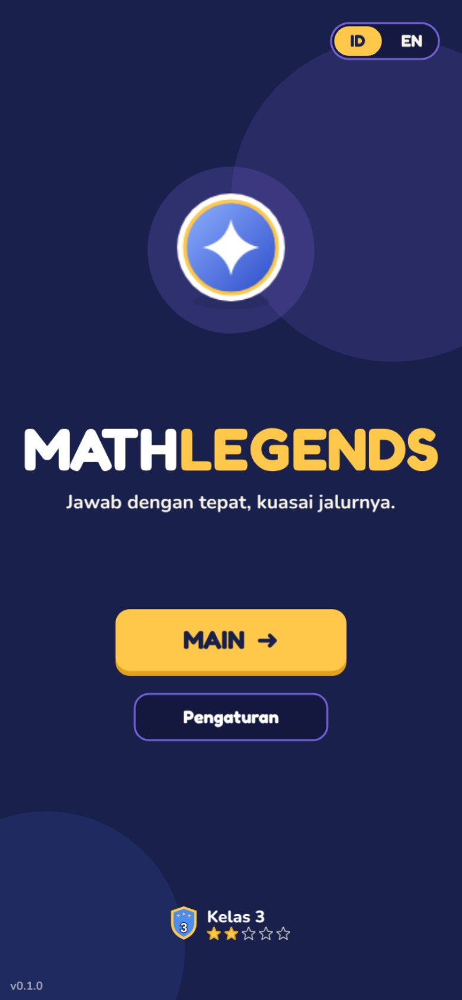
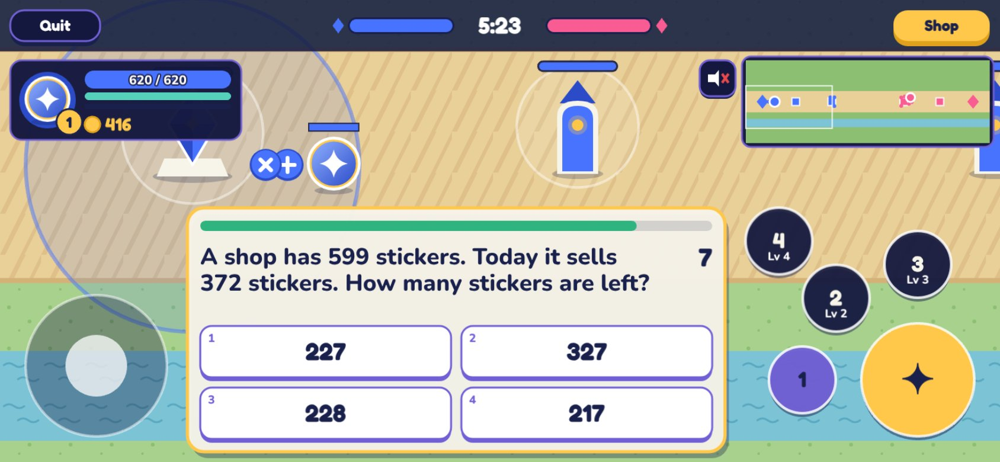
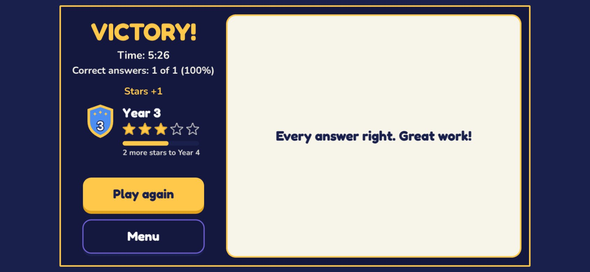
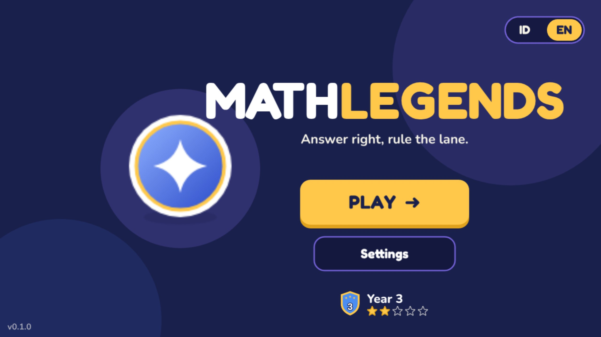

# MathLegends

**A math MOBA for primary school: every last hit asks a math question.**

### ▶ [Play now: hawreirei.github.io/Mathlegends](https://hawreirei.github.io/Mathlegends/)

Free, in the browser, on phones, tablets and computers. Indonesian and English. Installable and playable offline. No account, no ads, nothing sent anywhere. Version 0.1.0 ([what's in it](CHANGELOG.md)).

| Menu (phone) | In a match: a question on a last hit | Result |
|---|---|---|
|  |  |  |



## How to play

1. Tap **Play** ("Main"). You are the blue hero; the computer plays red. Everyone starts in **Year 1** and moves up by winning.
2. Move with the joystick (or WASD / arrow keys), attack with the gold button (or Space), and use your skills.
3. When **your** hit finishes off an enemy minion, a **math question** appears. The match keeps going while you answer: a right answer pays more gold and EXP.
4. Buy items in the **Shop**, push down the enemy's two towers and destroy their **Nexus** to win. Wins earn stars; 5 stars move you up a Year (Kelas 1 to 6), and the questions grow with you.

**On a phone:** open the link once, then use the browser menu → *Install app* / *Add to Home Screen*. After that it opens like an app and works in airplane mode ([details](docs/OFFLINE.md)).

**For teachers:** progress stays on each device; Settings → *Move to another device* copies it. Settings → *Answer data* downloads an anonymous CSV of every answer for research ([what it contains](docs/DATA.md)). Accessibility options: larger question text, colour-blind colours, extra time, reduce motion, sound and music switches.

## Credits

- **Made by** [Hawreirei](https://github.com/Hawreirei), built with the help of [Claude Code](https://claude.com/claude-code).
- **Game engine:** [Phaser](https://phaser.io/) (MIT).
- **Fonts:** [Fredoka](https://fonts.google.com/specimen/Fredoka) and [Nunito](https://fonts.google.com/specimen/Nunito) (SIL Open Font License 1.1), self-hosted via [Fontsource](https://fontsource.org/).
- **Art, sounds and music:** all original, made for this game (drawn and synthesised in code); every asset and its license is listed in [docs/ASSETS.md](docs/ASSETS.md).
- **Questions:** written and generated for the Indonesian Kurikulum Merdeka, Year 1 to 6 ([docs/CURRICULUM.md](docs/CURRICULUM.md)); a teacher review is pending.
- MathLegends is an original game. It is not affiliated with, and uses no names, heroes, art or audio from, Mobile Legends or any other game.
- **License:** MIT ([LICENSE](LICENSE)).

---

# For developers

A single-player 1-lane MOBA where every last-hit on a minion asks a math question. Correct answers turn into more gold and EXP. Ranks run from Year 1 to Year 6 (Indonesian curriculum) and set both the question difficulty and the bot's strength. Plays in English or Indonesian. No server needed.

- Full plan: [PLAN.md](PLAN.md)
- Issue backlog: [ISSUES.md](ISSUES.md)
- Rules for AI agents: [AGENTS.md](AGENTS.md)
- Tests and checks: [docs/TESTING.md](docs/TESTING.md); releasing a version: [docs/RELEASE.md](docs/RELEASE.md)

## Quick start
```
npm ci
npm run dev        # local dev server
npm run lint       # ESLint
npm test           # Vitest
npm run build      # type-check and build to dist/
npm run e2e        # smoke test in a real browser (after build; see docs/TESTING.md)
```

Requires Node 22 or newer.

## Deploy
Every push to `main` runs `.github/workflows/deploy.yml` and publishes to GitHub Pages.
One-time setup in GitHub: Settings > Pages > Source = **GitHub Actions**.

The site lives at `https://hawreirei.github.io/Mathlegends/`. The Vite `base` in `vite.config.ts` must stay `/Mathlegends/` (the path is case-sensitive).

After each deploy, the `verify-live` job checks that https://hawreirei.github.io/Mathlegends/version.json shows the deployed commit and plays a short match on the live site (phone and desktop, both languages). The Menu shows the version in its bottom-left corner.

## Scenes and screen sizes (#15)
Boot (loads art) > Menu > Match > Result, sharing a typed `GameState` (`src/systems/gameState.ts`) through the Phaser registry. The canvas is 1280x720 in landscape and 720x1280 in portrait, with the long side stretched to the screen's shape (`src/systems/layout.ts`), and switches when the device rotates. Scenes lay themselves out from the current size and rebuild on resize. All on-screen text comes from `src/data/i18n/` (`id.json`, `en.json`); `tests/i18n.test.ts` fails if a scene passes inline text to a text object or button, or if the two files' keys or `{placeholders}` differ.

`window.mathlegends.game` exposes the Phaser game for automated browser tests.

## Language (#23)
Indonesian or English, switched with the **ID | EN** toggle on the menu. The change redraws every screen at once and is saved on the device (`localStorage`, key `mathlegends.lang`; it moves into the versioned profile in #41). First visit: the browser language if it is English, otherwise Indonesian. Questions show their stem, explanation and word choices in the chosen language (`localize` and `choiceText` in `src/utils/i18n.ts`).

## Controls (#17, #18)
- **Keyboard:** WASD or arrow keys to move, Space to attack (hold to keep attacking).
- **Touch** (shown only on touch devices): a floating joystick (touch anywhere on the left half), a gold attack button and three skill buttons on the right. Two thumbs work at once. Controls keep clear of notches and the home bar using the CSS safe-area insets. The page blocks pinch-zoom, double-tap zoom, scrolling and the long-press menu.

## Combat (#19)
Attack hits the nearest living enemy within the hero's attack range, once every 1/attackSpeed seconds; a press during the cooldown is remembered for 0.4 s. Damage = ATK x 100 / (100 + ARMOR) from `economy.json`. Heroes regenerate HP, die at 0 HP and respawn at their own base with full HP after 5 + 1 x level seconds (a countdown shows at the base). Rules: `src/systems/combat.ts`, shared with minions (#20) and towers (#21).

## Match rules and the bot (#24)
All match rules run in `src/systems/match.ts` (`createMatch`, `stepMatch`): pure TypeScript that takes player input and returns the next state plus events (attacks, spawns, rewards, level-ups, last hits, winner). `MatchScene` only reads input and draws those events, and `tests/match.test.ts` plays full 10-minute matches headless. The bot (`src/systems/bot.ts`, settings in `src/data/bot.json`) holds the lane behind its minions, last-hits, fights the player when close and healthy, avoids standing under the player's towers alone, and walks home to heal in its base below 30% HP.

## HUD (#25)
Top bar: Quit, Nexus health for both teams (blue left, red right) and the match timer. Below it: the hero panel (portrait with level badge, HP bar with numbers, mana, EXP, gold) and the mini-map (lane, towers and Nexuses, grey when destroyed, minion dots, both heroes, camera view). While your hero is dead a centred message counts down to respawn. Every position comes from `src/systems/hudLayout.ts`; `tests/hud.test.ts` checks desktop, landscape and portrait phones (with and without notches) for elements off screen, under a notch or overlapping each other or the touch controls.

## Project layout
`src/{scenes,entities,systems,data,ui,utils}`, `tests/`, `docs/`, `scripts/`. Game rules live in `src/systems/` with no Phaser imports.
